# GlobalBooks

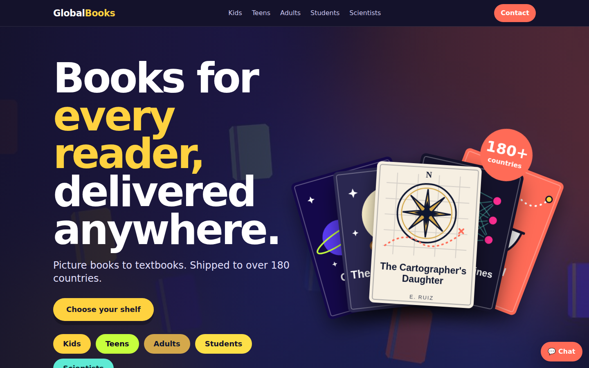

## What is this website for?

GlobalBooks is an online bookstore made for one simple idea: **every kind of reader should feel like the shop was made for them.**

Most bookstores put everything on one long list. Here, you start by saying who you're shopping for, and you land on a shelf that looks and sounds right for that person:

- **Kids** get bright colours, cartoons and picture books.
- **Teens** get a bold, loud look and stories about their world.
- **Adults** get a calmer, classic look with novels, history and non-fiction.
- **Students** get a notebook feel with study guides and academic books.
- **Scientists** get a lab-style look with research and science titles.

The shop promises to ship to over 180 countries, keep prices fair, and take returns without fuss. It's meant to feel friendly and easy for someone who just wants to find a good book and order it.

I built it as my web development course project, to practise making a site that reacts to what people do instead of just showing static pages.

## What a visitor can do

**Pick who they're shopping for.** The home page starts with a tile for each reader group.

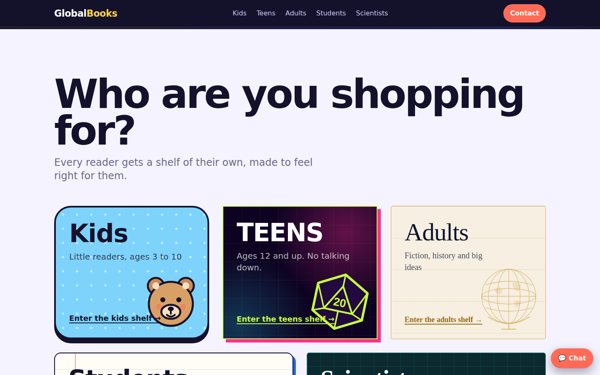

**Browse a shelf made for that reader.** Each group has its own banner, colours and drawings.

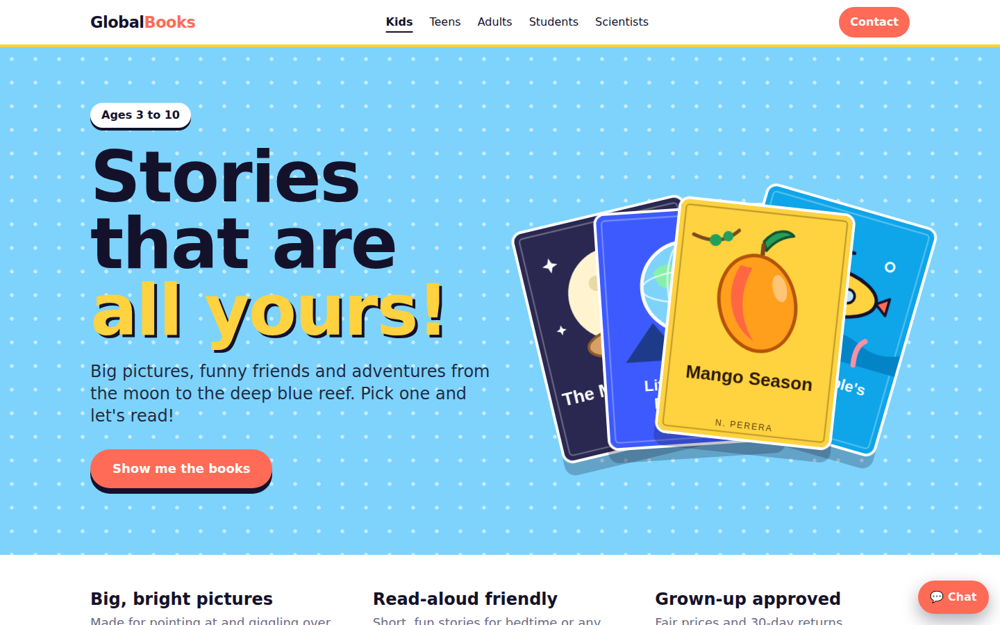

**Filter books by price.** Four buttons narrow the shelf down, and a counter says how many books are showing.

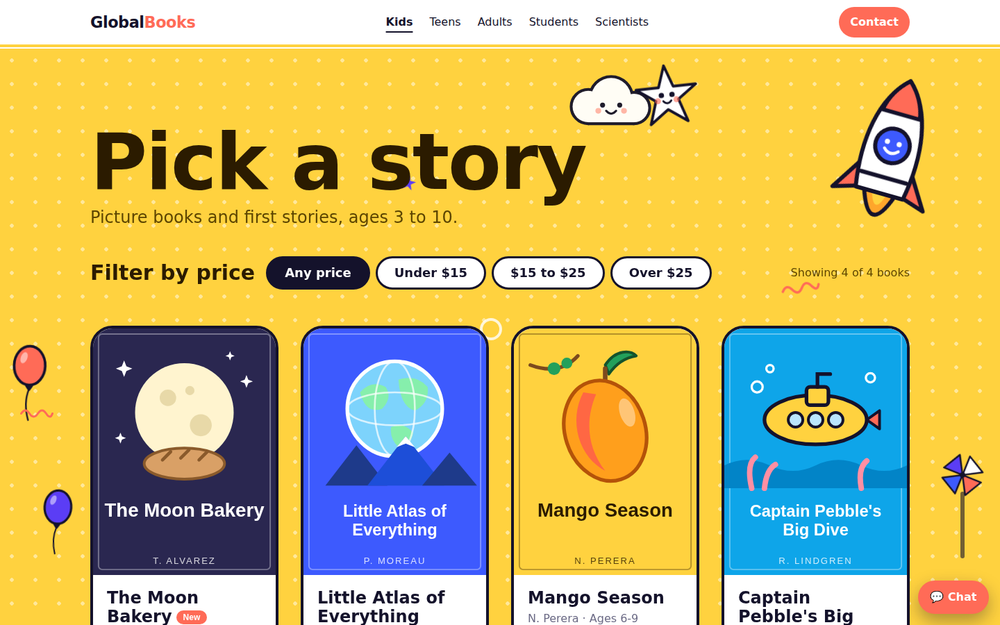

The scientists' shelf has a completely different feel:

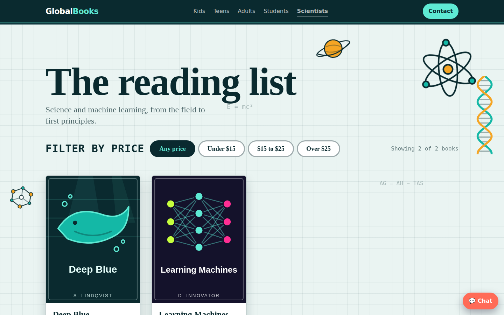

**Choose how many copies and order.** Every book has a small + and − control, and the Order button opens an email that already has the book and the number of copies filled in.

**Get a deal by email every Friday.** The newsletter box checks that the email looks right and then says thanks.


**Ask a real person.** The contact form first asks what the visitor needs, then only shows the questions that matter for that. Someone who wants help picking a book sees different fields than someone tracking an order.

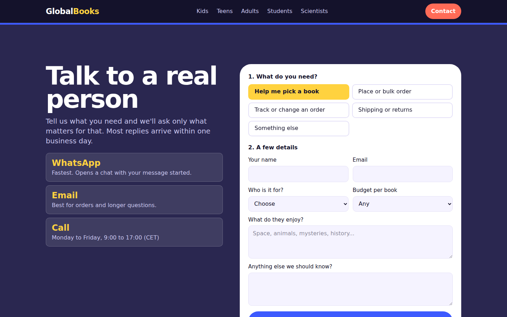

**Use it on a phone.** The site works on small screens too, with a menu button and swipeable rows of books.

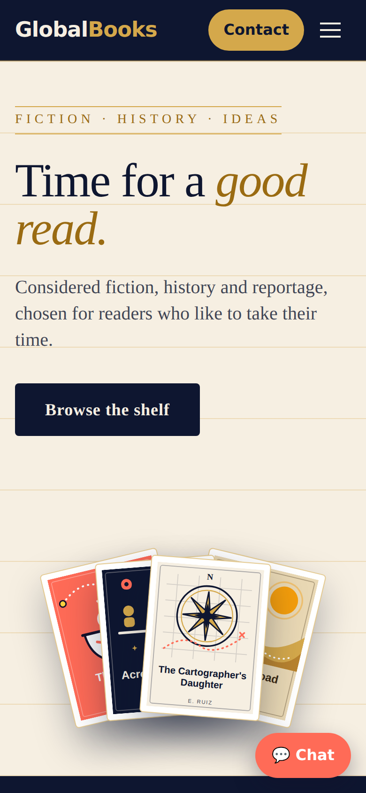

## How the page reacts to people

The parts of the site that change when someone does something are built with two ideas from React:

- **State** is the page's memory. It remembers things like whether the menu is open, how many copies someone picked, or what they typed in the newsletter box.
- **Events** are the things people do: clicking, typing, pressing a key. Each one runs a small piece of code that updates the memory, and the page redraws itself to match.

Here's what that looks like in the real code.

**The newsletter box** remembers the email and the message to show. It updates on every keystroke and checks the email when the form is sent.

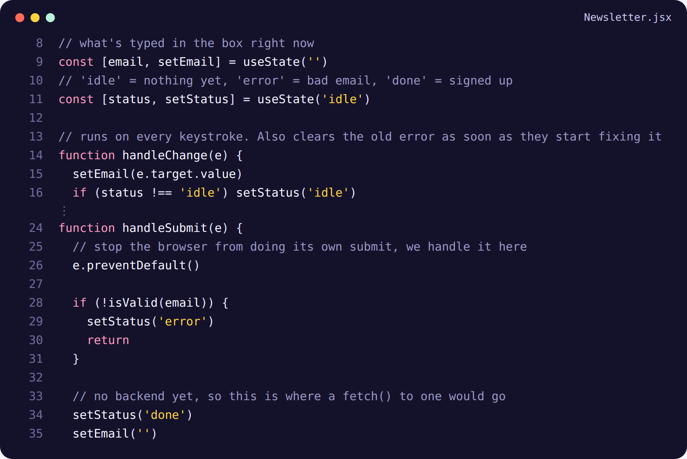

**The menu** remembers whether it's open. Clicking the button flips it, and pressing Escape closes it.

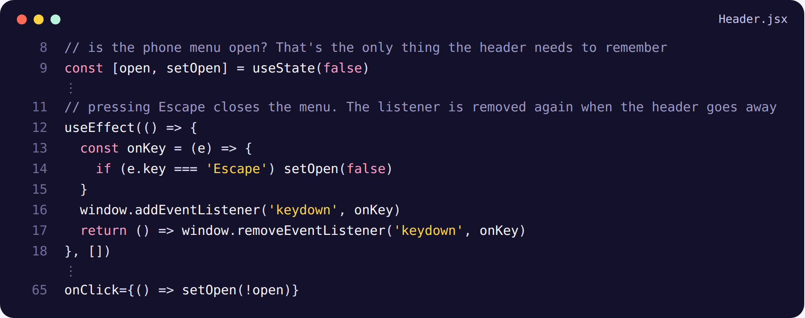

**Each book card** remembers its own number of copies, so changing one book never changes another.

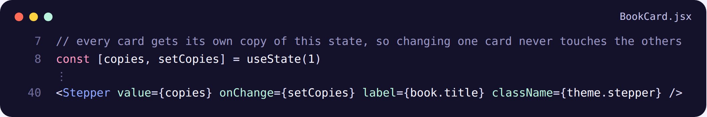

**The shelf** remembers which price filter is chosen and works out which books to show from that.

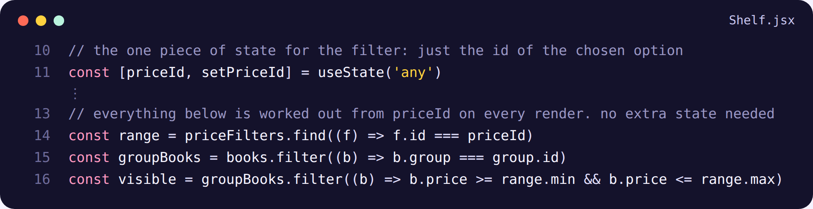

**The page switcher** reads the address (like `#/kids`) and tells the site which shelf to show, with no extra library.

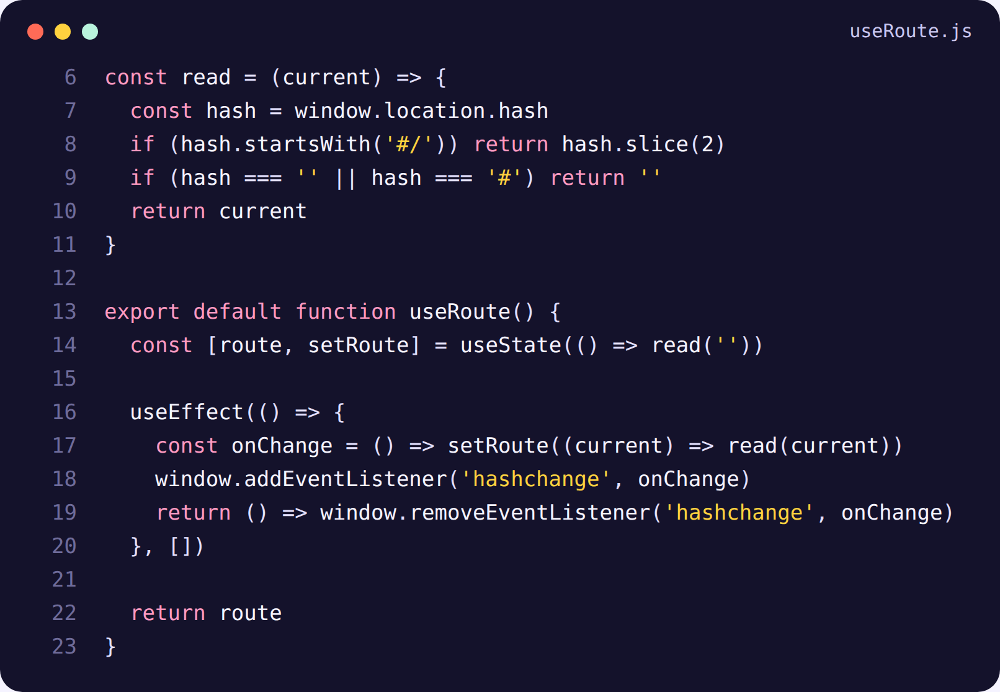

## Where things are on the page

**Home page, top to bottom:** header, opening banner, "Who are you shopping for?" tiles, scrolling book covers, the four promises, book of the month, a short video, the newsletter, the contact form and the footer. The floating "Chat" button stays in the bottom-right corner.

**Each reader page:** header, that group's banner, three short promises, the price filter and book grid, links to the other shelves, then the contact form and footer.

## Try it yourself

You need Node.js installed.

```bash
npm install
npm run dev
```

Then open the address it prints (usually http://localhost:5173).

## Good to know

- The books are stored in one simple file (`src/data/books.js`). To add a book, add one entry there and a cover picture with the same name in `public/assets/covers`.
- The email address and phone number in the contact section are placeholders.
- The newsletter doesn't send anything anywhere yet. It only shows the thank-you message.
- Ordering opens an email, since there's no online checkout.